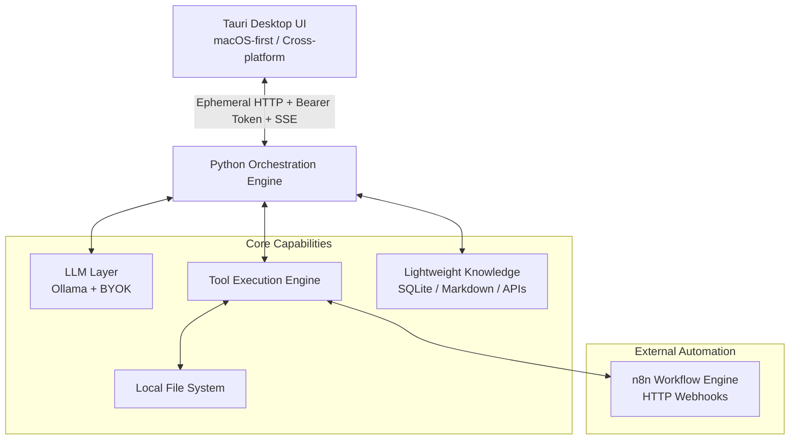
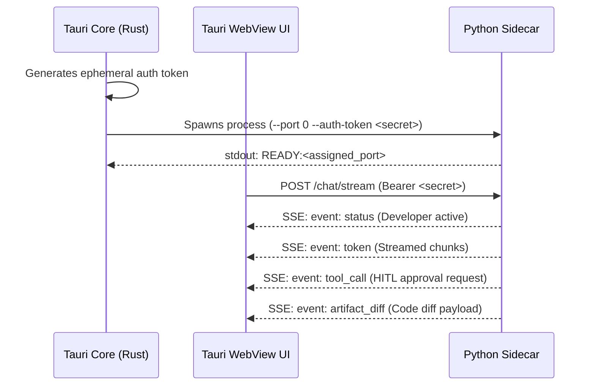
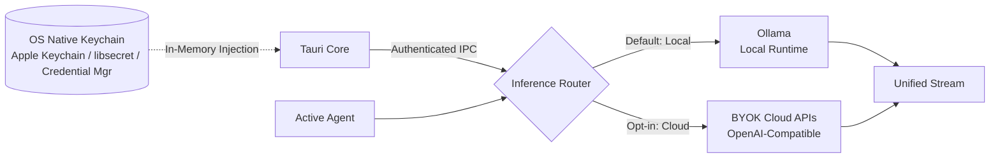
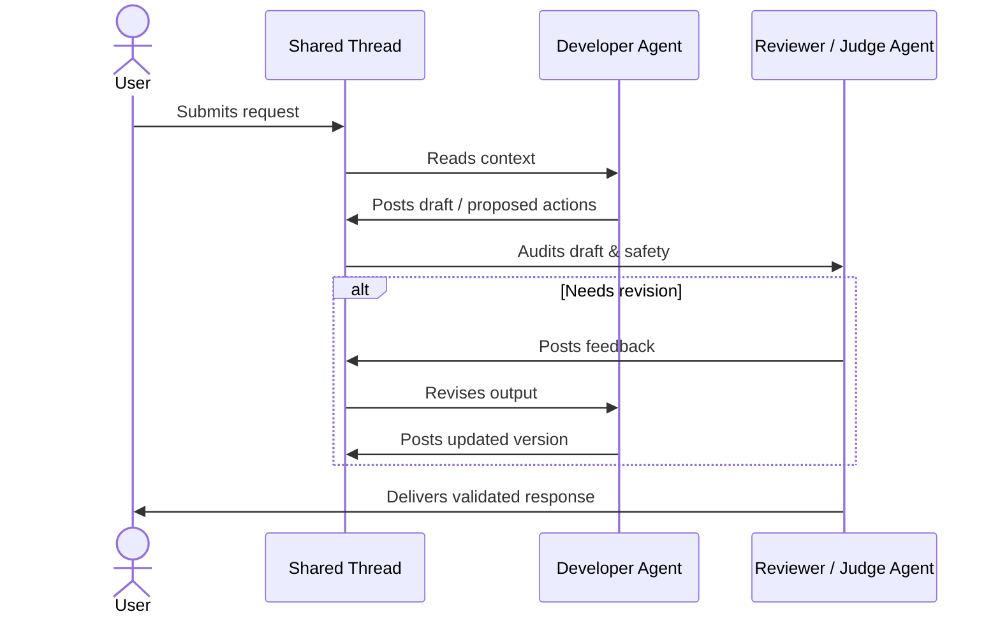
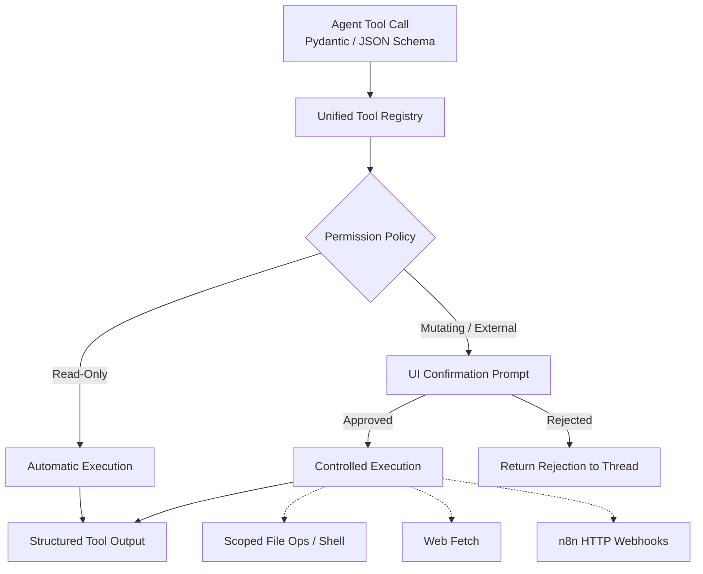
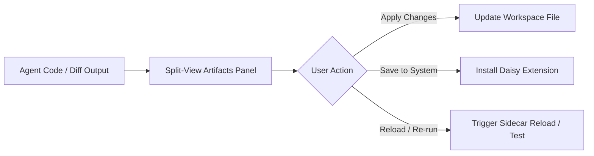
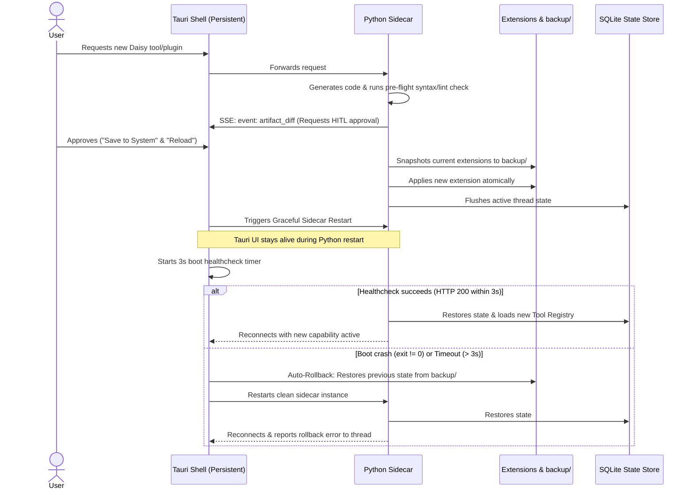
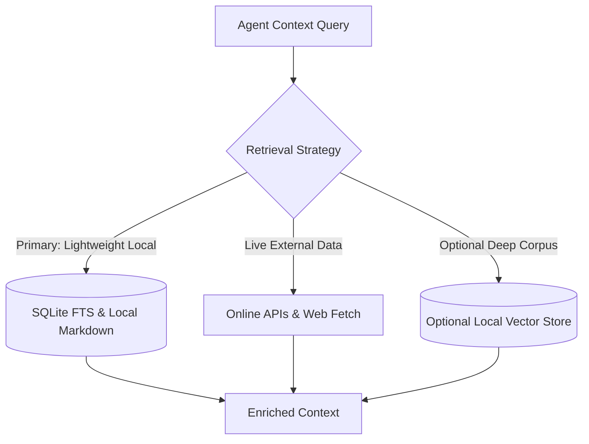
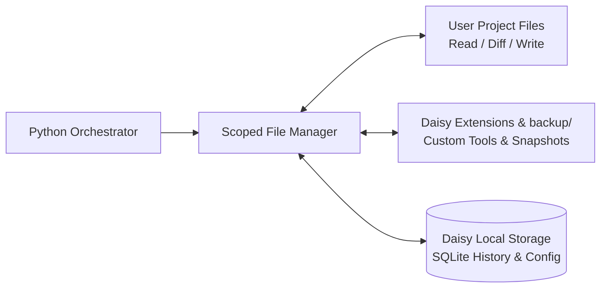

# System Architecture: Daisy

## 1. Philosophy & Core Principles

**Daisy** is a local-first personal AI assistant designed with a **macOS-first philosophy** while remaining cross-platform (Windows and Linux compatible via Tauri and Python).

* **Local-First & Private:** Daisy must perform inference locally via Ollama and store state locally by default.
* **BYOK Neutrality:** Daisy should support optional connections to OpenAI-compatible cloud APIs for heavy reasoning without intermediary infrastructure.
* **Collaborative Team:** Specialized agents (Developer and Reviewer/Judge) must collaborate sequentially within a shared conversation thread.
* **Lightweight Cross-Platform Shell:** Daisy must use Tauri to provide a native macOS experience while preserving compatibility with Windows and Linux.
* **Safe Self-Extensibility:** Daisy should be capable of extending its own toolset through validated code generation, explicit user approval, graceful sidecar restarts, and automatic rollback protection.

## 2. High-Level Overview

## 3. Unified IPC & Transport Protocol (Tauri <-> Python)

Tauri must act as a lightweight native wrapper around the web UI and manage the Python backend as an isolated local sidecar process over a secured, dynamically allocated loopback channel.

* **Dynamic Port Allocation & Handshake:**
  * At boot, Tauri must generate a cryptographically random ephemeral secret token and spawn the Python sidecar passing the token via a CLI argument (`--auth-token <token>`) and binding to an OS-assigned free localhost port (`127.0.0.1:0`).
  * The Python sidecar must emit its bound port via `stdout` during initialization (`READY:<port>`) and reject any HTTP request lacking a valid `Authorization: Bearer <token>` header. This prevents fixed-port collisions and blocks unauthorized local processes from querying the backend.
* **Standardized Server-Sent Events (SSE) Streaming:**
  * Real-time orchestration updates must stream from Python to the Tauri UI over SSE using a strict event schema:
    * `event: token` — Incremental text tokens generated by the active agent.
    * `event: tool_call` — Structured tool invocation payload and HITL permission status.
    * `event: artifact_diff` — Unified diff payloads routed to the Split-View Artifacts panel.
    * `event: status` — Agent state transitions (e.g., Developer drafting, Reviewer auditing, Sidecar reloading).

## 4. Inference Layer & BYOK Secret Storage

The orchestrator should route model requests locally to Ollama by default, or externally via user-provided API keys (BYOK) when configured.

* **Zero Plaintext Credential Storage:**
  * Daisy must never store BYOK API keys in plaintext inside SQLite, configuration files, or `.env` files on disk.
* **OS-Native Keychain Integration:**
  * Under macOS, Daisy should delegate secret storage to **Apple Keychain** via `keyring-rs` or `tauri-plugin-stronghold` (and symmetrically use `libsecret` on Linux and Windows Credential Manager on Windows).
  * Tauri must retrieve keys in memory only when required and inject them securely per-request to the Python sidecar over the authenticated IPC channel.

## 5. Collaborative Agents (Developer & Reviewer/Judge)

Agents must share a single conversation thread. The Reviewer/Judge should audit the Developer's output and proposed tool actions before presenting the final result to the user.

## 6. Tool Protocol & Execution Engine

Daisy must expose a unified tool registry defined via Pydantic models and JSON Schema on the Python side to guarantee structured, deterministic invocation.

* **Tool Typology:**
  * **Scoped File Ops:** `read_file`, `write_file`, and `apply_diff` restricted to authorized directories.
  * **Controlled Shell Execution:** Sandboxed command execution with timeout and environment restrictions.
  * **External Workflows:** Asynchronous and synchronous HTTP webhook triggers connected to an **n8n** automation engine.
  * **Web Fetch:** Lightweight HTTP retrieval for external documentation and live data.
* **Human-in-the-Loop (HITL) Governance:**
  * Read-only operations (`read_file`, `web_fetch`) should execute automatically without interrupting the agent workflow.
  * Mutating or side-effect operations (`write_file`, `apply_diff`, shell commands, external n8n webhooks, and self-reload triggers) must pause execution and require explicit user confirmation in the UI.

## 7. Artifacts & Code Lifecycle

When agents generate code, diffs, or configuration changes, Daisy should render them in a dedicated **Split-View Artifacts** panel alongside the conversation thread.

* **Diff-First Rendering:** Proposed modifications must be displayed as structured diffs (`event: artifact_diff`) to highlight exact additions and deletions.
* **Explicit User Actions:** The Artifacts panel must provide direct lifecycle controls:
  * **Apply Changes:** Writes the validated diff to the target workspace file.
  * **Save to System:** Registers new tools or plugins into Daisy's internal extension directory.
  * **Reload / Re-run:** Triggers a runtime reload or re-executes the target script/workflow to verify behavior.

## 8. Self-Extension, Lifecycle & Auto-Rollback Architecture

Users should be able to ask Daisy to extend its own capabilities (such as adding a new tool, webhook integration, or plugin) without risking application stability.

* **Pre-Flight Validation & Snapshot Backup:**
  * Before modifying system extensions, Daisy must run a sandboxed pre-flight syntax and linting check on the generated code.
  * Upon user approval, Daisy should copy the current extension state into a versioned `backup/` snapshot directory before applying the new code atomically.
* **Graceful Sidecar Restart & State Continuity:**
  * The Tauri shell must remain active and responsive while the Python sidecar flushes active conversation state to SQLite and performs a graceful restart.
* **Safe Failure & Automatic Rollback:**
  * After restarting the sidecar, Tauri must monitor the boot healthcheck (enforcing a strict `3s` timeout and monitoring process exit codes).
  * If the healthcheck times out or the Python sidecar exits with a non-zero code due to a runtime error in the new extension, Tauri must automatically restore the previous snapshot from `backup/` and restart the sidecar, ensuring Daisy never enters a broken state.

## 9. Knowledge Retrieval (Lightweight Local & Online APIs)

Daisy should prioritize lightweight local retrieval using SQLite full-text search, local Markdown files, and direct API calls before resorting to heavy vector indexing.

## 10. Local File System Integration

Agents must interact with the host file system through a scoped file manager that enforces workspace boundaries and separates user files from internal application state.

